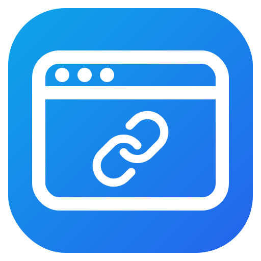
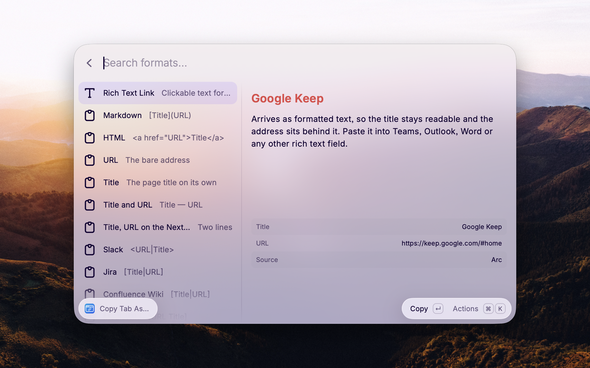

<div align="center">



# Copy Tab Link

**Share the page you are on as a link people can actually click.**<br>
A [Raycast](https://raycast.com) extension that copies the current browser tab as a clean rich text link for Teams,
Outlook and Word – or as Markdown, Slack, Jira and 15 more formats.

[](https://github.com/jnbp/raycast-copy-tab-link/releases/latest)


[](LICENSE)

[**Download the installer**](https://github.com/jnbp/raycast-copy-tab-link/releases/latest/download/install-copy-tab-link.zip) · [Features](#features) · [Commands](#commands) · [FAQ](#faq)

<br>



</div>

---

## Why

Paste a URL into Teams or Outlook and you get a wall of `https://…?utm_source=…`. What you wanted was the page title
as a clickable link. Browsers don't give you that, and the formats differ everywhere: Markdown in your notes,
`<URL|Title>` in Slack, `[Title|URL]` in Jira.

Copy Tab Link reads the tab you are looking at, cleans it up and puts it on the clipboard in the right shape – with
one hotkey.

## Features

<table>
<tr>
<td width="50%" valign="top">

### 🔗 Real rich text links
**Copy Tab as Rich Text Link** puts RTF, HTML and plain text on the clipboard at once, so Teams, Outlook, Word,
Notes and Notion each pick the flavour they understand. **Paste Tab as Rich Text Link** drops it straight into the
field you are typing in.

</td>
<td width="50%" valign="top">

### 🧾 18 formats and your own
Markdown, HTML, URL, title, Slack, Jira, Confluence, MediaWiki, AsciiDoc, reStructuredText, Org Mode, BBCode,
Textile, LaTeX and more – plus a custom template with tokens like `{title}`, `{url}`, `{domain}` and `{date}`.

</td>
</tr>
<tr>
<td width="50%" valign="top">

### 👀 Pick with a live preview
**Copy Tab As…** lists every format with a preview of exactly what lands on the clipboard. **Copy All Tabs** turns
the whole front window into a bullet, numbered or plain list.

</td>
<td width="50%" valign="top">

### 🧹 Clean links and titles
Strips tracking parameters (`utm_*`, `fbclid`, `gclid`, `si` and many more) and optionally the fragment. Tidies
titles: drops a trailing `| Site Name`, emoji, unread counters, or anything your own regular expressions match.

</td>
</tr>
</table>

## Commands

| Command | What it copies |
| --- | --- |
| **Copy Tab as Rich Text Link** | A formatted, clickable link for Teams, Outlook, Word |
| **Paste Tab as Rich Text Link** | The same, pasted straight into the active field |
| **Copy Tab as Markdown Link** | `[Title](URL)` |
| **Copy Tab as Plain Text** | The bare URL, the title, or `Title — URL`, as configured |
| **Copy Tab in Custom Format** | Your own template |
| **Copy Tab As…** | Any format, picked from a list with a live preview |
| **Copy All Tabs** | Every tab of the frontmost window as a list |

> [!TIP]
> Give **Copy Tab as Rich Text Link** a hotkey: open Raycast, select the command, press `⌘K` → **Configure Command**.

<details>
<summary><b>How the rich text reaches the clipboard</b></summary>

<br>

Apps disagree about what a formatted link looks like. Microsoft Teams, Outlook and Word want RTF and ignore a bare
`<a href>`; browsers and Notion want HTML; a plain text field wants neither. By default the extension writes **all
three at once**, so every app picks the flavour it understands. The plain text alternative is configurable: the
URL, the title, both, or the Markdown link.

If one app still refuses the link, set **Rich Text Method** to *RTF Only*, the route that has always worked for
Teams, Outlook and Word.

</details>

<details>
<summary><b>Title cleanup with your own patterns</b></summary>

<br>

Separate several regular expressions with `;;`. For example, `\s*[-|] Google Docs$;;^\(\d+\)\s*` removes the
"Google Docs" suffix and the unread counter some sites put in front of the title.

</details>

<details>
<summary><b>Supported browsers</b></summary>

<br>

Through AppleScript, with nothing extra to install: Arc, Dia, Chrome, Chromium, Brave, Edge, Vivaldi, Opera, Safari,
Orion, Sidekick, Comet, Helium, Shift, Wavebox, Whale and Yandex, including beta and canary builds. You can also pin
one browser in the preferences instead of following whichever app is in front.

Firefox and Zen don't expose their tabs to AppleScript; for those, the extension falls back to the
[Raycast browser extension](https://www.raycast.com/browser-extension) for single links. **Copy All Tabs** stays
AppleScript only, because the browser extension cannot tell which window a tab belongs to.

</details>

## Installation

### Option 1 – Installer (recommended)

1. Download **[install-copy-tab-link.zip](https://github.com/jnbp/raycast-copy-tab-link/releases/latest/download/install-copy-tab-link.zip)** and double-click it to unzip.
2. Double-click **install-copy-tab-link.command**.

The installer checks for Raycast and Node.js, downloads the latest release and imports the extension. **Run the
same file again to update** – it always fetches the newest release and keeps your preferences.

> [!NOTE]
> Downloaded scripts are not signed by Apple, so macOS may block the first double-click. Open **System Settings ›
> Privacy & Security** and click **Open Anyway**, or start it from Terminal, which is never blocked:
>
> ```bash
> bash ~/Downloads/install-copy-tab-link.command
> ```

### Option 2 – From source

```bash
git clone https://github.com/jnbp/raycast-copy-tab-link.git
cd raycast-copy-tab-link
npm install && npm run dev
```

**Requirements:** macOS, [Raycast](https://raycast.com) and Node.js 22 or newer.

## FAQ

<details>
<summary><b>Teams or Outlook pastes the bare URL.</b></summary>

Set **Rich Text Method** to *RTF Only* in the extension preferences. Those apps prefer RTF over HTML.
</details>

<details>
<summary><b>Why not just use Copy Path?</b></summary>

[Copy Path](https://www.raycast.com/koinzhang/copy-path) copies paths and URLs. Copy Tab Link is about sharing a page
as a formatted link: rich text, 18 formats, previews, all tabs at once and link cleanup.
</details>

<details>
<summary><b>Does it send any data anywhere?</b></summary>

No. Everything happens locally. No URL or page title ever leaves your machine.
</details>

## License

[MIT](LICENSE) © jnbp
